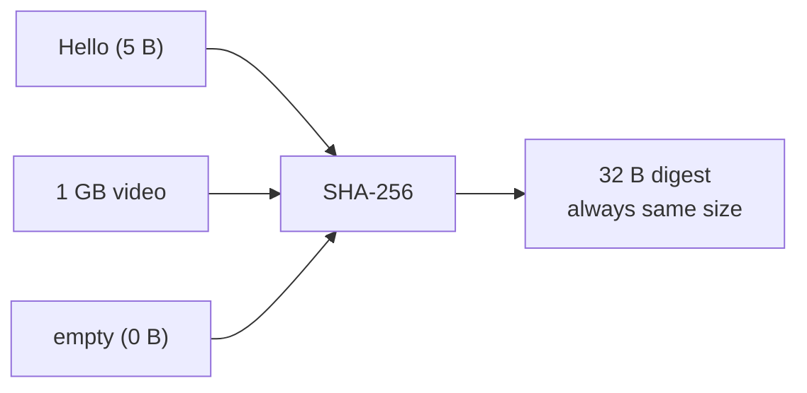
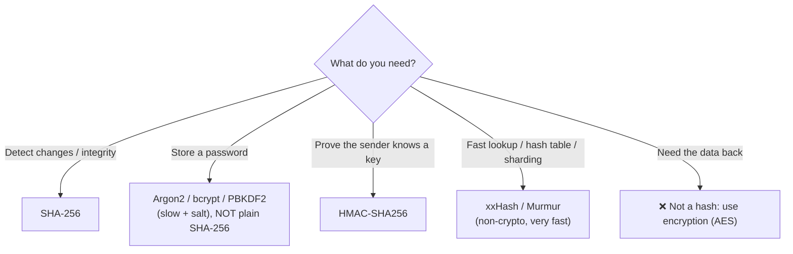
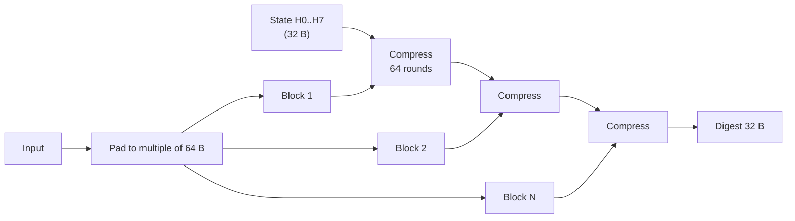
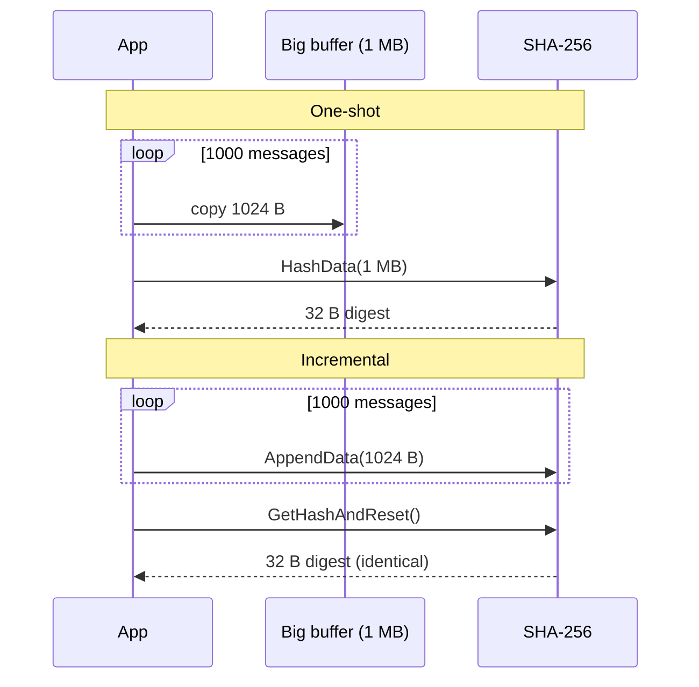
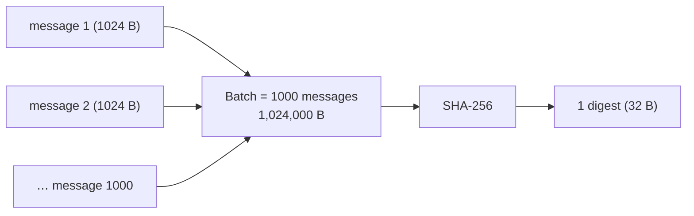
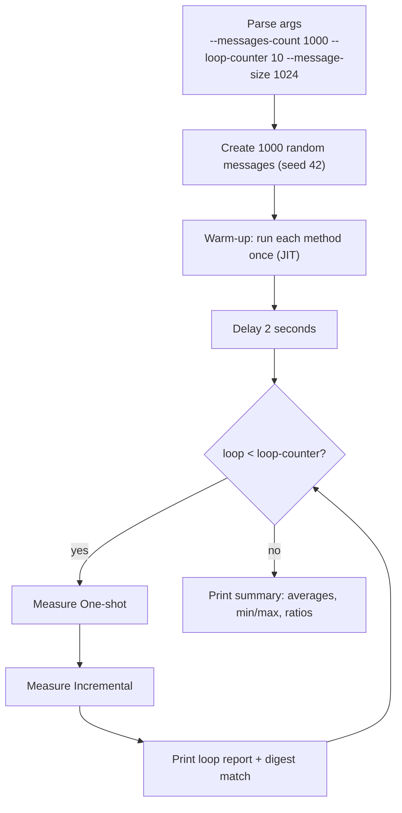

# Hash: Incremental vs One-shot (.NET, SHA-256)

A learning repo: what a hash is, where it is used, how SHA-256 works, and a runnable .NET benchmark that compares **one-shot** and **incremental** hashing of 1000 messages.

```bash
cd src/HashBenchmark
dotnet run -c Release -- --messages-count 1000 --loop-counter 10
```

---

## 1. What is a hash?

**Definition:** a hash function turns input of **any size** into a **fixed-size** fingerprint (the *digest*). Same input → same digest, always. You cannot get the input back from the digest.

**Example (story, real values from `sha256sum`):**
```
Initial data:
  input A           : "Hello"  (5 B)
  input B           : "Hellp"  (5 B, one letter changed)
  input C           : ""       (0 B)

Commands:
  sha256("Hello")   : 185f8db32271fe25f561a6fc938b2e264306ec304eda518007d1764826381969
  sha256("Hellp")   : 2113cd4a7aebc3a400a234c3de8a5c0c4d9fa8c6ca370d030aac9ab51e8c4476
  sha256("")        : e3b0c44298fc1c149afbf4c8996fb92427ae41e4649b934ca495991b7852b855

Result:
  digest size       : 32 B for every input (0 B, 5 B, or 5 GB)
  one letter change : digest is completely different (avalanche effect)
  reverse           : impossible: 32 B cannot hold the original 5 GB
```



### Properties of a good (cryptographic) hash

| Property | Meaning | Example |
|---|---|---|
| Deterministic | Same input → same output | `"Hello"` → `185f8d…` today and in 10 years |
| Fixed size | Output length never changes | SHA-256 → always 32 B |
| Avalanche | 1-bit change → ~50% of output bits flip | `Hello` vs `Hellp` above |
| Pre-image resistant | Cannot find input from digest | Given `185f8d…`, finding `"Hello"` = brute force |
| Collision resistant | Cannot find two inputs with the same digest | No known SHA-256 collision |

---

## 2. When do we use a hash?

Use a hash when you need to **compare, identify, or verify** data **without** keeping or sending the data itself.



| ✅ Correct usage | ❌ Wrong usage | Why wrong |
|---|---|---|
| `sha256(file)` to check a download | `sha256(password)` stored in DB | Fast hash → GPU tries billions/sec; use Argon2 + salt |
| HMAC-SHA256 to sign an API request | `sha256(key + message)` as signature | Length-extension attack on SHA-256; HMAC fixes it |
| xxHash for a hash table key | xxHash for file integrity against attackers | xxHash is not collision resistant |
| Hash to compare data | Hash to "encrypt" data | A hash cannot be decrypted |

---

## 3. Use cases

| Use case | How the hash is used | Real example |
|---|---|---|
| File integrity | Publisher prints digest; you hash your copy and compare | Linux ISO downloads ship `SHA256SUMS` |
| Content addressing | The digest **is** the ID/name of the data | Git commits, Docker image layers (`sha256:…`) |
| Password storage | Store `slowhash(salt + password)`, never the password | Argon2 / bcrypt |
| Message authentication | `HMAC(key, message)` sent with message | JWT `HS256`, AWS Signature V4 |
| Digital signatures | Sign the 32 B digest, not the 1 GB document | TLS certificates (RSA/ECDSA over SHA-256) |
| Deduplication | Same digest → same content → store once | Backup tools, Dropbox-like sync |
| Blockchain | Each block contains the hash of the previous block | Bitcoin (double SHA-256) |
| Hash tables / sharding | `hash(key) % N` picks bucket / node | `Dictionary<TKey,TValue>`, Cassandra partitioner |

---

## 4. Hash algorithms

**Definition:** a hash algorithm is the exact recipe (block size, rounds, constants) that produces the digest. They differ in **security**, **speed**, and **output size**.

Digests of `"Hello"` (real values):
```
MD5      (16 B) : 8b1a9953c4611296a827abf8c47804d7
SHA-1    (20 B) : f7ff9e8b7bb2e09b70935a5d785e0cc5d9d0abf0
SHA-256  (32 B) : 185f8db32271fe25f561a6fc938b2e264306ec304eda518007d1764826381969
SHA-512  (64 B) : 3615f80c9d293ed7402687f94b22d58e529b8cc7916f8fac7fddf7fbd5af4cf7… (first 32 B)
```

| Algorithm | Output | Family | Status | Typical use | .NET API |
|---|---|---|---|---|---|
| MD5 | 128 bit | Merkle–Damgård | ❌ Broken (collisions in seconds) | Legacy checksums only | `MD5.HashData` |
| SHA-1 | 160 bit | Merkle–Damgård | ❌ Broken (SHAttered, 2017) | Legacy Git, old certs | `SHA1.HashData` |
| **SHA-256** | 256 bit | SHA-2 (Merkle–Damgård) | ✅ Secure, default choice | TLS, Bitcoin, Docker, JWT | `SHA256.HashData` |
| SHA-384 / SHA-512 | 384 / 512 bit | SHA-2 | ✅ Secure, faster than SHA-256 on 64-bit CPUs | Long-term signatures | `SHA512.HashData` |
| SHA3-256 | 256 bit | Keccak (sponge) | ✅ Secure, different design (backup to SHA-2) | Ethereum (Keccak variant) | `SHA3_256.HashData` (.NET 8+, if OS supports) |
| BLAKE2 / BLAKE3 | 256 bit | ChaCha-based / tree | ✅ Secure, very fast | Argon2 internals, file sync | NuGet package |
| xxHash / Murmur | 32–128 bit | Non-crypto | ⚠️ Not secure, extremely fast | Hash tables, sharding, checksums | `System.IO.Hashing.XxHash64` (NuGet) |
| CRC32 | 32 bit | Checksum | ⚠️ Detects accidents only | ZIP, Ethernet, PNG | `System.IO.Hashing.Crc32` (NuGet) |
| bcrypt / scrypt / Argon2 / PBKDF2 | 128–256 bit | Password hash (slow on purpose) | ✅ For passwords only | Login systems | `Rfc2898DeriveBytes.Pbkdf2` |

> This repo uses **SHA-256**: the most common secure hash, built into .NET with no package.

---

## 5. How does SHA-256 hash data?

**Definition:** SHA-256 splits the input into **64 B blocks** and mixes each block into an **internal state of 8 × 32-bit words (32 B)**. The final state is the digest.

**Steps (pseudocode):**
```
1. state = H0..H7                         // 8 fixed constants (fractional parts of √ of first 8 primes)
2. pad(input):
     append 0x80                          // one '1' bit
     append 0x00 until length ≡ 56 (mod 64)
     append original length in bits as 8 B big-endian
3. for each 64 B block:
     W[0..15]  = block as 16 words
     W[16..63] = expand(W)                // σ0, σ1: rotations + shifts + XOR
     a..h = state
     repeat 64 rounds:                    // Σ0, Σ1, Ch, Maj + round constant K[i]
         mix a..h with W[i] and K[i]
     state += a..h                        // add, mod 2^32
4. digest = state as 32 B big-endian
```

**Example (story):** `"Hello"` (5 B)
```
Initial data:
  input             : 0x48656c6c6f (5 B)

Commands:
  pad               : 48656c6c6f 80 00…00 0000000000000028   (5 + 1 + 50 + 8 = 64 B, 0x28 = 40 bits)
  blocks            : 1 block of 64 B
  compress(block)   : 64 rounds → new state

Result:
  digest            : 185f8db32271fe25f561a6fc938b2e264306ec304eda518007d1764826381969
```



**Key insight for the rest of this repo:** the algorithm only ever needs **the current state (32 B) + one 64 B block**. It never needs the whole input in memory. That is exactly why **incremental hashing** is possible.

---

## 6. Incremental vs One-shot (Comparison)

### 6.1 Definitions

| Option | Definition (< 50 words) |
|---|---|
| **One-shot** | The whole input already sits in one buffer; a single call (`SHA256.HashData(buffer)`) hashes it. If data arrives in pieces, you must first copy all pieces into one big buffer. |
| **Incremental** | Feed the input piece by piece (`IncrementalHash.AppendData(piece)`); the object keeps only the 32 B state + a partial block. Call `GetHashAndReset()` at the end. Same digest as one-shot. |

### 6.2 Example per option (same scenario: 1000 messages × 1024 B)

**One-shot** ([OneShotHasher.cs](src/HashBenchmark/OneShotHasher.cs)):
```csharp
var buffer = new byte[totalLength];          // 1,024,000 B copy of all messages

foreach (var message in messages)
{
    message.CopyTo(buffer, offset);

    offset += message.Length;
}

return SHA256.HashData(buffer);
```

**Incremental** ([IncrementalHasher.cs](src/HashBenchmark/IncrementalHasher.cs)):
```csharp
using var hash = IncrementalHash.CreateHash(HashAlgorithmName.SHA256);

foreach (var message in messages)
{
    hash.AppendData(message);                // no copy, only the state is updated
}

return hash.GetHashAndReset();
```



### 6.3 Comparison table

Measured with this repo (Intel i5-7200U, no SHA-NI, .NET 10.0.13, Release, 10 loops, averages):

| Criteria | One-shot | Incremental |
|---|---|---|
| Input must be in memory | All of it, as one buffer | Only the current piece |
| Extra memory | O(total size) | O(1): ~32 B state + 64 B block |
| **Cost: allocated per batch** | **1,024,120 B** | **276 B** (avg) |
| **Cost: avg time per batch** | **3.776 ms** | **3.151 ms** |
| Batches per second | 265 | 317 |
| Messages per second | 264,823 | 317,339 |
| Throughput | 259 MB/s | 310 MB/s |
| GC collections (10 loops) | Gen0 2, Gen1 2, Gen2 2 | 0 |
| GC pause (10 loops) | 1.382 ms | 0 ms |
| Large Object Heap (> 85 KB) | Yes: 1 MB buffer each call | No |
| Digest | `2226b125…598d98554` | `2226b125…598d98554` (same) |
| Code size | Copy loop + 1 call | Create, append loop, finish |
| Best for | Small input already in one array | Streams, many messages, big files |

### 6.4 Positives

**One-shot**
- Simplest API: one line `SHA256.HashData(bytes)`.
- Fastest when the data is **already** one array (no copy needed).
- Static method: no object, no `Dispose`.
- Easy to use with `Span<byte>` / `stackalloc` for tiny inputs.

**Incremental**
- Constant memory: hash 10 GB with a 4 KB buffer.
- No copy of the pieces → faster in this benchmark (1.20x).
- Zero GC pressure (276 B vs 1 MB per batch).
- Works on data that arrives over time (network, stream, TLS transcript).

### 6.5 Negatives

**One-shot**
- Needs all data in one buffer → copy cost + 1 MB allocation per batch.
- Buffers > 85 KB go to the LOH → triggers Gen2 GC (2 here in 10 loops).
- Impossible for data larger than RAM or not yet received.

**Incremental**
- More code: create, append, finish, dispose.
- Object holds native state: must `Dispose` (`using`).
- Not thread-safe: one instance per thread / per hash.
- Slight per-call overhead for very small inputs (object creation).

### 6.6 Other solutions

**a. One-shot per message** (existing)
- **Definition:** hash each message on its own → 1000 digests, not 1. Different meaning: proves each message, not the batch.
- **Example (pseudocode):** `for m in messages: digests.add(sha256(m))` → 1000 × 32 B = 32,000 B of digests.
- **Positives:** parallel-friendly; can verify one message alone; no big buffer.
- **Negatives:** 1000 digests to store; no single fingerprint of the batch; 1000 allocations of 32 B.

**b. Stream hashing** (existing)
- **Definition:** `SHA256.HashData(stream)` / `HashDataAsync(stream)` reads the stream in chunks and hashes incrementally inside .NET.
- **Example (code):** `await using var file = File.OpenRead("big.iso"); var digest = await SHA256.HashDataAsync(file);`
- **Positives:** one line; constant memory; async I/O.
- **Negatives:** needs a `Stream`; hides chunk size; not for in-memory message lists.

**c. One-shot with a pooled buffer** (suggested)
- **Definition:** rent the big buffer from `ArrayPool<byte>.Shared` instead of `new byte[]`, return it after hashing.
- **Example (code):** `var buf = ArrayPool<byte>.Shared.Rent(total); … SHA256.HashData(buf.AsSpan(0, total)); ArrayPool<byte>.Shared.Return(buf);`
- **Positives:** removes most allocation and GC; still one-shot API.
- **Negatives:** copy cost remains; must remember `Return`; pool keeps 1 MB alive.

**d. Incremental with zero allocation** (suggested)
- **Definition:** reuse one `IncrementalHash` instance and write the digest into a caller span with `GetHashAndReset(Span<byte>)`.
- **Example (code):** `Span<byte> digest = stackalloc byte[32]; hash.GetHashAndReset(digest);`
- **Positives:** ~0 B per batch; fastest steady state.
- **Negatives:** instance reuse → careful with threads; slightly harder code.

**e. Merkle tree / tree hashing** (existing)
- **Definition:** hash each piece, then hash pairs of hashes up to one root. BLAKE3 does this internally.
- **Example (Mermaid):**
  ```mermaid
  flowchart BT
      m1[msg1] --> h1[h1]
      m2[msg2] --> h2[h2]
      m3[msg3] --> h3[h3]
      m4[msg4] --> h4[h4]
      h1 --> h12[h12]
      h2 --> h12
      h3 --> h34[h34]
      h4 --> h34
      h12 --> root[root]
      h34 --> root
  ```
- **Positives:** parallel on all cores; prove one piece with log₂(N) hashes.
- **Negatives:** more code; digest differs from a plain SHA-256 of the data.

### 6.7 Common systems

| System | Uses | Reference |
|---|---|---|
| TLS 1.3 handshake | Incremental: running "transcript hash" over every handshake message | [RFC 8446 §4.4.1](https://www.rfc-editor.org/rfc/rfc8446#section-4.4.1) |
| GNU `sha256sum` | Incremental: reads the file in blocks | [coreutils manual](https://www.gnu.org/software/coreutils/manual/html_node/sha2-utilities.html) |
| .NET `SHA256.HashData(Stream)` | Stream hashing (incremental inside) | [Microsoft Docs](https://learn.microsoft.com/dotnet/api/system.security.cryptography.sha256.hashdata) |
| Bitcoin block header | One-shot: double SHA-256 of a fixed 80 B header | [Bitcoin developer reference](https://developer.bitcoin.org/reference/block_chain.html#block-headers) |
| Git objects | Content addressing: hash of `header + content` is the object ID | [Pro Git: Git Objects](https://git-scm.com/book/en/v2/Git-Internals-Git-Objects) |
| OCI / Docker images | Content addressing: `sha256:` digest per layer | [OCI image spec: digests](https://github.com/opencontainers/image-spec/blob/main/descriptor.md#digests) |
| BLAKE3 | Tree hashing (Merkle) | [BLAKE3 repo](https://github.com/BLAKE3-team/BLAKE3) |

### 6.8 My opinion

| Option | Opinion |
|---|---|
| **One-shot** | Perfect when the bytes are already one small array (token, header, key). Building a big buffer just to call it is waste: 1 MB per batch and Gen2 GCs here. |
| **Incremental** | The right default for many messages, streams, or anything large: same digest, constant memory, no GC, and faster in this benchmark because nothing is copied. |

**Recommended:** **Incremental** for batches/streams; one-shot only for small data already in one buffer.

---

## 7. The benchmark

### Terms: message and batch

| Term | Definition | In this repo |
|---|---|---|
| **Message** | One piece of data to hash | One `byte[]` of 1024 random bytes (`--message-size`) |
| **Batch** | All the messages hashed together into **one** 32 B digest | 1000 messages (`--messages-count`) = 1,024,000 B |

One batch = one measured operation, so **Batches/s** = whole batches hashed per second and **Messages/s** = Batches/s × messages-count.

```
Initial data:
  message size      : 1024 B
  messages-count    : 1000
  batch size        : 1000 × 1024 = 1,024,000 B (~1 MB)

Commands:
  one-shot(batch)   : copy 1000 messages → 1 MB buffer → SHA256.HashData → 32 B
  incremental(batch): AppendData × 1000 → GetHashAndReset → 32 B

Result:
  digest            : 2226b125…598d98554 (same for both)
  avg time / batch  : 3.776 ms (one-shot), 3.151 ms (incremental)
  Batches/s         : 1 / 0.003776 s ≈ 265 (one-shot)
  Messages/s        : 265 × 1000 ≈ 264,823 (one-shot)
```



### What it does



### Metrics reported

| Metric | Source | Meaning |
|---|---|---|
| Time (ms) | `Stopwatch` | Time to hash the whole batch |
| Allocated (B) | `GC.GetAllocatedBytesForCurrentThread()` | Bytes allocated on the heap during the call |
| Batches/s | `1 / time` | Whole batches expected per second |
| Messages/s | `Batches/s × messages-count` | Messages hashed per second |
| MB/s | `Batches/s × total bytes` | Throughput |
| Gen0 / Gen1 / Gen2 | `GC.CollectionCount(n)` | Garbage collections that happened during the call |
| GC pause (ms) | `GC.GetTotalPauseDuration()` | Time the app was paused by the GC |
| Digest match | compare both digests | Proves both methods compute the same SHA-256 |

### Options

| Option | Default | Meaning |
|---|---|---|
| `--messages-count` | 1000 | Number of messages per batch |
| `--loop-counter` | 10 | How many times each method is measured |
| `--message-size` | 1024 | Bytes per message |

### Run

```bash
cd src/HashBenchmark
dotnet run -c Release -- --messages-count 1000 --loop-counter 10
```

### Real output (Intel i5-7200U, .NET 10.0.13)

```
SHA-256 | 1000 messages x 1024 B | 10 loops | .NET 10.0.13
Waiting 2 seconds ...

Loop 1/10
  Method       |  Time (ms) |  Allocated (B) |  Batches/s |  Messages/s |   MB/s | Gen0 | Gen1 | Gen2 | GC pause (ms)
  One-shot     |      4.718 |      1,024,120 |        212 |     211,954 |    207 |    0 |    0 |    0 |         0.000
  Incremental  |      3.223 |            232 |        310 |     310,318 |    303 |    0 |    0 |    0 |         0.000
  Digest match: yes  2226b125c1ae5dc003e11cd918d20b90df8c4847c6a15299079bcae597d98554

Loop 4/10
  Method       |  Time (ms) |  Allocated (B) |  Batches/s |  Messages/s |   MB/s | Gen0 | Gen1 | Gen2 | GC pause (ms)
  One-shot     |      4.377 |      1,024,120 |        228 |     228,451 |    223 |    1 |    1 |    1 |         0.757
  Incremental  |      3.174 |            456 |        315 |     315,090 |    308 |    0 |    0 |    0 |         0.000
  Digest match: yes  2226b125c1ae5dc003e11cd918d20b90df8c4847c6a15299079bcae597d98554

... (loops 2, 3, 5-10 omitted)

Summary (average of 10 loops)
  Method       |  Time (ms) |  Allocated (B) |  Batches/s |  Messages/s |   MB/s | Gen0 | Gen1 | Gen2 | GC pause (ms)
  One-shot     |      3.776 |      1,024,120 |        265 |     264,823 |    259 |    2 |    2 |    2 |         1.382
  Incremental  |      3.151 |            276 |        317 |     317,339 |    310 |    0 |    0 |    0 |         0.000

  Time  min/max  One-shot   : 3.219 / 5.148 ms
  Time  min/max  Incremental: 2.731 / 5.791 ms
  Incremental is 1.20x the speed of one-shot and allocates 3711x less memory.
```

### Reading the result

- **Allocated:** one-shot = 1,024,000 B buffer + 32 B digest + ~88 B object headers = 1,024,120 B. Incremental = `IncrementalHash` object + 32 B digest ≈ 232 B.
- **GC:** the 1 MB buffer lands on the **Large Object Heap**; every few loops the LOH budget fills and a **Gen2** collection runs (loops 4 and 8 → 0.757 ms and 0.625 ms pauses).
- **Time:** both run the same SHA-256 compression over 1,024,000 B; one-shot also copies 1 MB first → ~0.6 ms slower.
- **Noise:** single runs jump (loop 9: incremental 5.791 ms) because of OS scheduling; trust the average, or use [BenchmarkDotNet](https://benchmarkdotnet.org/) for statistically solid numbers.

## Project layout

```
src/HashBenchmark/
  Program.cs            args → messages → warm-up → delay 2 s → loops → summary
  Options.cs            parses --messages-count, --loop-counter, --message-size
  MessageFactory.cs     creates N random messages (seed 42)
  OneShotHasher.cs      method 1: copy into one buffer, SHA256.HashData
  IncrementalHasher.cs  method 2: IncrementalHash.AppendData per message
  Measurement.cs        time, allocations, GC counts, GC pause for one call
  Report.cs             per-loop table + summary
```
